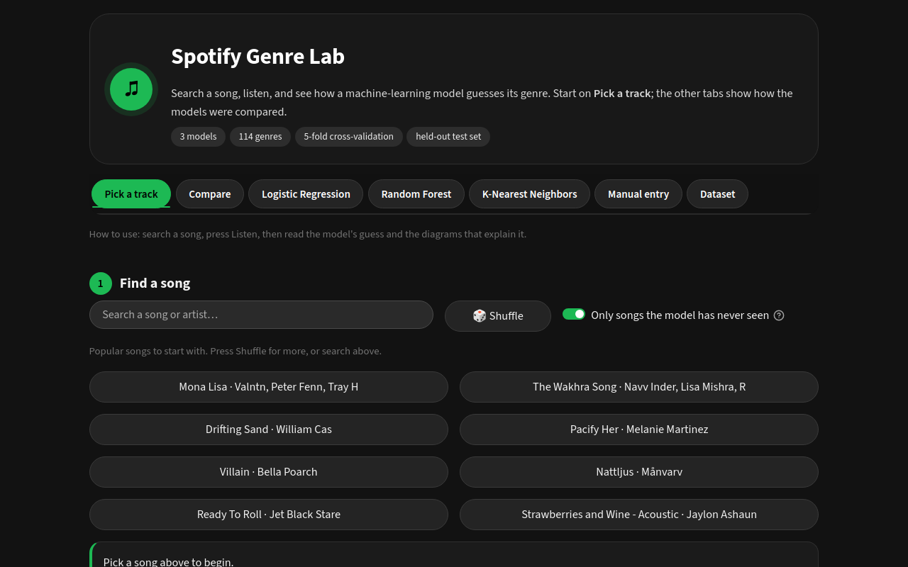
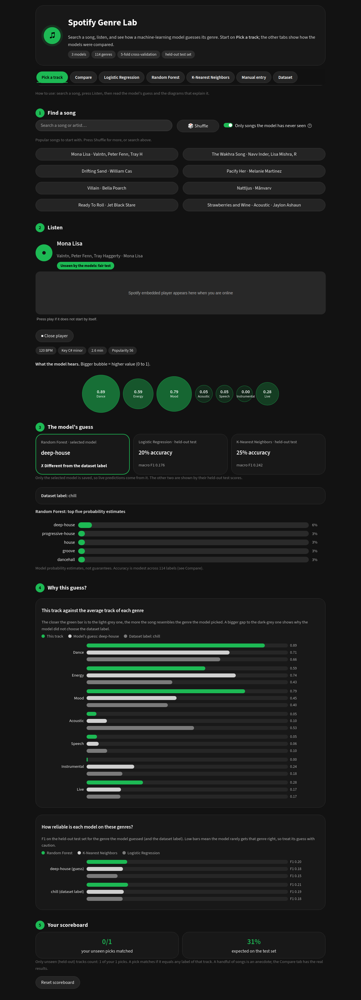
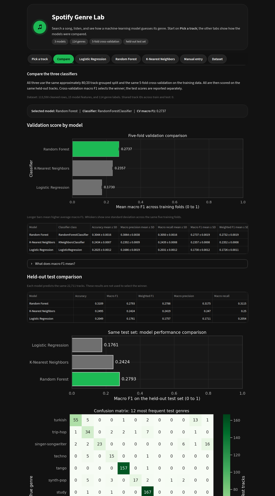
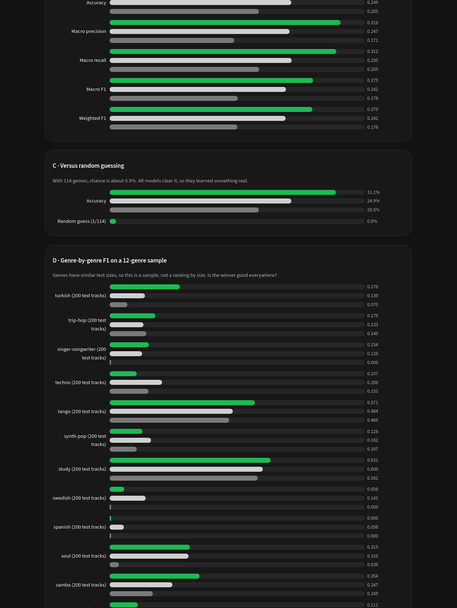
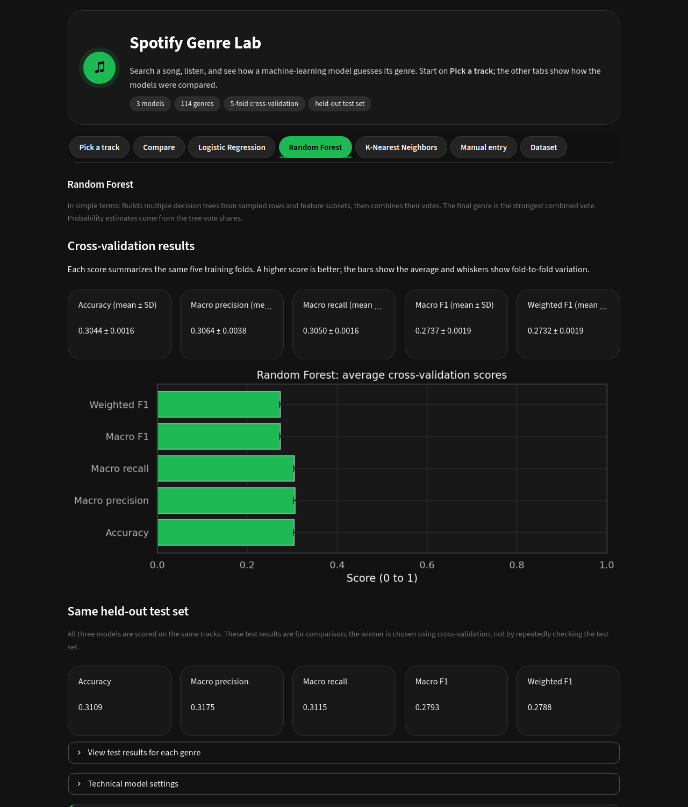
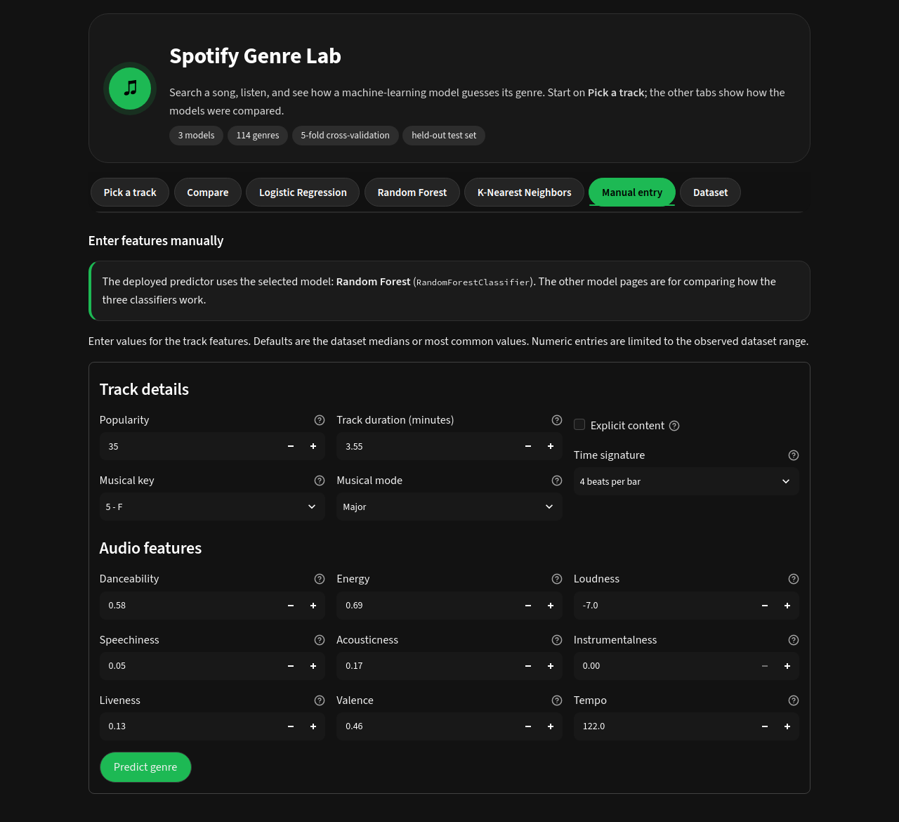
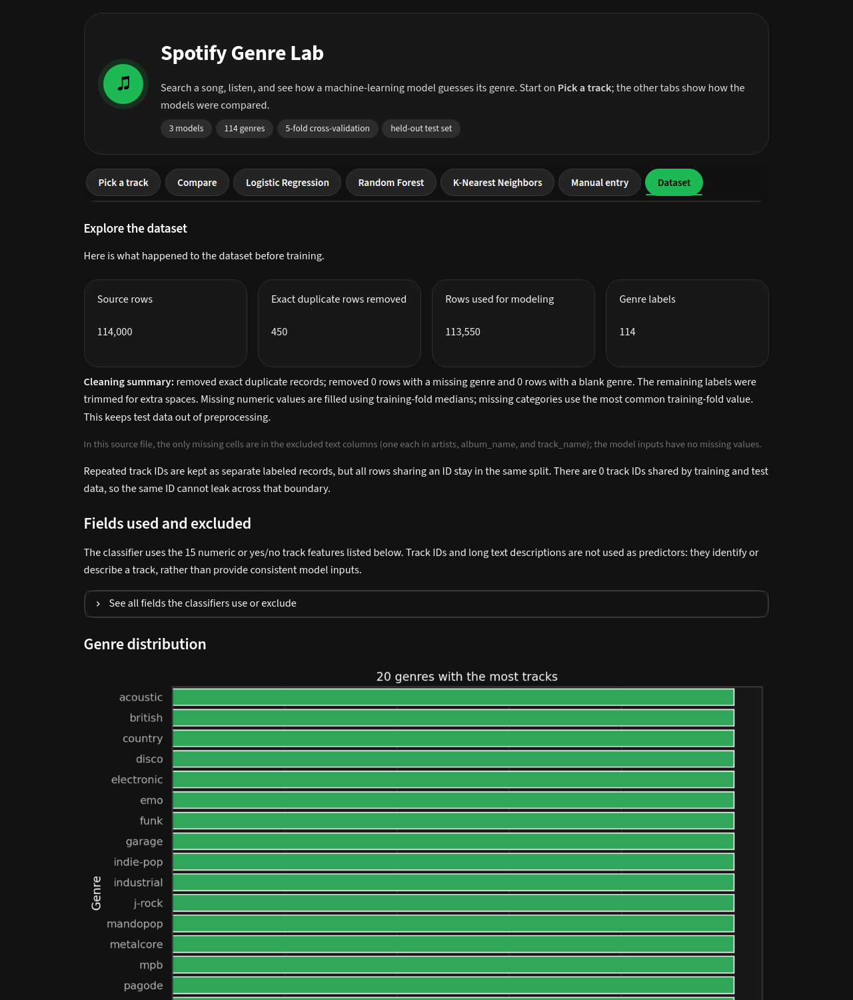
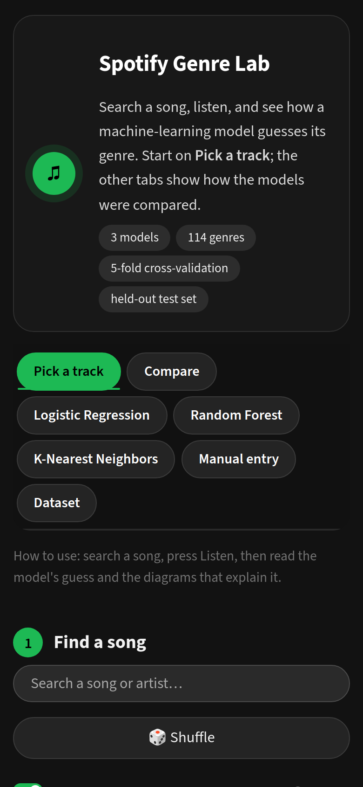
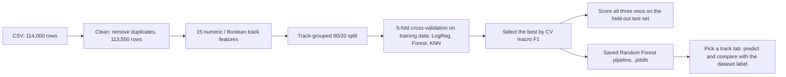

# Spotify Genre Lab: Introduction to Machine Learning Project

A student machine-learning study that compares **three classifiers** (Logistic Regression, Random Forest, K-Nearest Neighbors) on Spotify track genre prediction, wrapped in a **Spotify-themed Streamlit dashboard**. Search a song, press **Listen on Spotify**, see the audio features the model hears, and watch the selected model try to guess its genre, with diagrams that explain why. The study itself (cross-validation, held-out test set, confusion matrices) is on the other tabs.

> Academic demonstration. This is **not** an official Spotify service and not a production genre-recognition system.

## Explore the System:

**Pick a track.** Search a song or artist, or shuffle popular songs.



**Prediction result.** Press **Listen on Spotify** and the embedded player starts. Below it: audio features as bubbles, the model's guess against the dataset label, top-5 probabilities, two *why this guess* diagrams and a session scoreboard. (The screenshot shows a placeholder where Spotify's player appears when you are online.)



**Compare.** Cross-validation and held-out test results for all three models.



**Why this model?** The Compare tab ends with side-by-side evidence for why one classifier beats the others: grouped metric bars, a genre-by-genre sample, confusion matrices for all three models and a verdict computed from the saved results.



<table>
<tr>
<td width="50%"><b>Model page</b> (one per classifier)<br></td>
<td width="50%"><b>Manual entry</b> (type the features yourself)<br></td>
</tr>
<tr>
<td><b>Dataset</b> (cleaning steps and genre counts)<br></td>
<td><b>Mobile</b><br></td>
</tr>
</table>

## Developers and Researchers:

- **Group 7**
- Santos
- Pedido
- Lopez

**Contact:** [@Krdusk](https://github.com/Krdusk) on GitHub, or open an [issue](https://github.com/Krdusk/Spotify-Genre-Classification/issues).

## Project Objective:

The goal is to test Logistic Regression, Random Forest, and K-Nearest Neighbors on the same Spotify track dataset. The models are compared using five-fold cross-validation. The model with the highest mean validation macro F1 is selected, and all three models are also evaluated on the same held-out test set.

This is an academic demonstration, not an official Spotify service or a production-ready genre-recognition system.

## Results:

The selected model is Random Forest. Selection is based on cross-validation macro F1, not the held-out test scores.

| Model | Cross-validation macro F1 | Held-out test accuracy | Held-out test macro F1 |
|---|---:|---:|---:|
| Logistic Regression | 0.1730 | 0.2049 | 0.1761 |
| Random Forest | 0.2737 | 0.3109 | 0.2793 |
| K-Nearest Neighbors | 0.2357 | 0.2495 | 0.2424 |

The test scores describe this dataset and should not be interpreted as expected performance on other Spotify tracks.

## How it works:



1. **Preparation.** Duplicates are removed and IDs and free-text columns are dropped. Preprocessing is fitted inside each training fold so test data never leaks in.
2. **Study.** All three models use the same split and the same 5 folds. The winner is chosen by **cross-validation macro F1**, not by the test score. All three are then scored on the same held-out tracks. Tracks sharing an ID stay in the same split.
3. **Dashboard.** Opening the app loads the saved model and results. **It does not retrain.**

### The Pick a Track Tab:

**Listen on Spotify.** The button renders Spotify's embedded player (via Spotify's iFrame API) and calls `play()`. Autoplay depends on your browser and Spotify session: full songs need you to be logged in to Spotify in that browser, otherwise you hear a preview, and some browsers block autoplay, in which case press play. If the iFrame API cannot load, a plain embedded player is shown.

1. A catalog is built from the dataset: one entry per track ID (89,741 tracks), each marked **unseen** (in the held-out test set) or **seen** (in training).
2. You search or shuffle and pick a track. By default only unseen tracks are offered, so every pick is a fair test. Seen tracks are labelled *not a fair test*.
3. The track's 15 features go through the saved Random Forest pipeline. The app shows its guess, top-5 probabilities, and the dataset's label(s) for that track.
4. The scoreboard counts only unseen picks and shows the model's expected test accuracy beside them. A pick matches if the prediction equals any of the track's labels. A few songs are an anecdote, not a result.
5. The audio features come from the bundled dataset, not the Spotify API, because Spotify restricted audio-feature access for new apps in late 2024 (see Spotify's developer docs). The embedded player is Spotify's public embed and needs an internet connection. **Only the selected model is saved**, so live predictions come from Random Forest. The other two appear as their held-out test scores.

### Dashboard Guide:

- **Pick a track**: search, listen, predict and see the diagrams.
- **Compare**: cross-validation comparison, model selection, held-out test comparison, confusion matrices, and the *Why this model?* evidence and verdict.
- **Logistic Regression**, **Random Forest**, **K-Nearest Neighbors**: plain-language model descriptions, score graphs and test metrics for each classifier.
- **Manual entry**: type the 15 features yourself and get a prediction.
- **Dataset**: data cleaning, the feature list, genre counts and data-quality notes.

## Run the Application:

Requirements: Python 3.12 (the app was developed on Windows and also tested on Linux with Python 3.12).

**Windows**

```
py -3.12 -m venv .venv
.\.venv\Scripts\python.exe -m pip install -r requirements.txt
.\.venv\Scripts\python.exe -m streamlit run app\streamlit_app.py
```

Or double-click `start_app.bat` after installing.

**macOS / Linux**

```
python3.12 -m venv .venv
.venv/bin/python -m pip install -r requirements.txt
.venv/bin/python -m streamlit run app/streamlit_app.py
```

Open `http://localhost:8501`. Keep the terminal open while using the app and press Ctrl+C to stop it.

**Run in VS Code:**

1. Install [Python 3.12](https://www.python.org/downloads/) (tick *Add python.exe to PATH*) and [VS Code](https://code.visualstudio.com/) with the *Python* extension.
2. In VS Code: **File → Open Folder…** and choose the project folder (the one containing `app/` and `requirements.txt`).
3. Open the terminal: **Terminal → New Terminal**.
4. Create the environment and install the packages (Windows PowerShell):
   ```
   py -3.12 -m venv .venv
   .\.venv\Scripts\python.exe -m pip install -r requirements.txt
   ```
5. Press **Ctrl+Shift+P → Python: Select Interpreter** and pick `.venv`.
6. Start the app:
   ```
   .\.venv\Scripts\python.exe -m streamlit run app\streamlit_app.py
   ```
   Your browser opens `http://localhost:8501`. If it does not, open that address yourself.
7. Stop it with **Ctrl+C** in the terminal. Next time, only step 6 is needed (or double-click `start_app.bat`).

**Troubleshooting:**

- *Unpickle / version warning:* install from `requirements.txt`. The saved model was built with the pinned scikit-learn version.
- *Autoplay does not start:* browsers can block autoplay and full songs need a Spotify login in the same browser. Press play on the player. Without a login you hear a 30-second preview.
- *A song is missing from search:* the dataset covers about 90,000 tracks, so some songs are not in it. Use the Manual entry tab to type features yourself.
- *Spotify player is blank:* it needs an internet connection and may be blocked by some networks or extensions. The "Open in Spotify" route still works from the Spotify app.
- *"The project dataset is missing":* keep the CSV in `data/original/`. Do not keep a second copy at the project root.
- *PowerShell says scripts are disabled:* you do not need to activate the environment. Use the full `.\.venv\Scripts\python.exe` commands above.
- *Port 8501 is busy:* add `--server.port 8502` to the run command.
- *Search finds nothing:* the dataset covers about 90,000 tracks, mostly international. Tagalog and OPM songs are rare (for example Zack Tabudlo, Adie, Kamikazee). Untick *Only tracks the models never saw* to search all tracks.

## Static Web Preview (no install):

`documentation/web_preview.html` is a self-contained snapshot of the Pick a track experience (search, shuffle, listen, diagrams) plus the model-comparison diagrams (cross-validation, test metrics, per-genre F1, confusion matrices and a verdict). It holds precomputed Random Forest predictions for every unique track, so you can open it by double-clicking in any browser, with no Python. It is a snapshot generated from `models/spotify_genre_pipeline.joblib` and is not part of the app runtime.

## Dataset and Preparation:

The supplied CSV contains 114,000 rows, 20 columns, and 114 genre labels. Exact duplicate rows are removed, leaving 113,550 records. No genre labels are missing or blank. The model uses 15 numeric or Boolean track features:

`popularity`, `duration_ms`, `explicit`, `danceability`, `energy`, `key`, `loudness`, `mode`, `speechiness`, `acousticness`, `instrumentalness`, `liveness`, `valence`, `tempo`, and `time_signature`.

The `track_id`, `artists`, `album_name`, and `track_name` fields are excluded from the model inputs. They identify records or contain free text, rather than the numeric or Boolean features used by these classifiers. The CSV has one missing value in each of the three excluded text fields. Preprocessing is fitted within each training fold; if model input values are missing, the pipeline imputes numeric values using the training median and categorical values using the most frequent training value.

Tracks with the same track ID are kept together when making the training and test split. This prevents the same ID from appearing in both partitions. Some repeated tracks in the source have conflicting genre labels, which is a limitation of the data.

The project team has confirmed permission to redistribute the included CSV. The original dataset citation, source URL, publisher, and license information have not yet been recorded in the project. Add those details to `data/original/source_note.md` before academic submission.

## Project Structure:

```
project-root/
  app/               Streamlit application files.
  data/
    original/        Source CSV and dataset source note.
    processed/       Cleaned dataset when applicable.
  notebooks/         EDA and model development notebooks.
  src/               Reusable preprocessing and modeling code.
  models/            Saved best model or complete pipeline.
  documentation/     Technical documentation, screenshots, and web preview.
  paper/             Final DOCX and PDF.
  README.md          Setup and run instructions.
  requirements.txt   Exact software dependencies.
```

This project is maintained by **Group 7**. The `data/original/`, `data/processed/`, `notebooks/`, `src/`, `models/`, and `paper/` directories are currently placeholders; add the corresponding project assets there. The dataset, model artifacts, reusable source modules, and dependency manifest described elsewhere in this README are not currently present, so the full Streamlit application cannot run until those files are supplied.

Inside `app/`: `streamlit_app.py` (tabs and study pages), `picker.py` (Pick a track), `justify.py` (why-this-model evidence), `charts.py` (bar and heatmap helpers) and `theme.py` (colours and layout). `documentation/` also holds `screenshots/` and `web_preview.html`. The hidden `.streamlit/config.toml` sets the dark Spotify theme.

## Limitations:

- The task distinguishes among 114 genre labels, and model performance is modest.
- Some track IDs have more than one genre label in the source data.
- Dataset-specific test results do not establish performance on new or live Spotify data.
- Complete the source citation and license fields in `data/original/source_note.md` before submission.
- Live predictions use only the selected model, because only it is saved. A fair score on a few picked songs is not a performance estimate.
- The dataset contains few Filipino songs, and none of its 114 genre labels is OPM or Filipino, so the model cannot answer "OPM".
- The Spotify embed requires an internet connection and is not controlled by this project.
